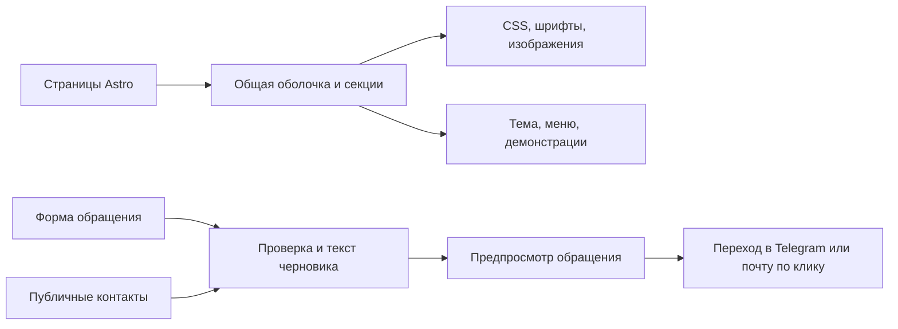

# Архитектура kitsoe

Сайт собирается Astro в статические HTML, CSS и небольшие браузерные модули TypeScript. Сервер приложения, база данных и обработчик заявок не нужны: форма готовит текст обращения на устройстве посетителя.

## Сайт

- `src/pages/index.astro` задаёт порядок секций. Страницы конфиденциальности, условий и 404 используют ту же оболочку.
- `src/layouts/Layout.astro` подключает шрифт, стили, навигацию и клиентскую логику; формирует SEO и социальные метаданные. Тема восстанавливается до первого отображения страницы.
- `src/components/` содержит самостоятельные секции. Демонстрации лампы, записи и списка задач существуют только в браузере и обозначены как примеры интерфейсов.
- `src/styles/global.css` хранит типографику, цвета, отступы, адаптивные правила и движение в CSS layers.
- `src/scripts/site.ts` управляет темой, нативным мобильным диалогом, демонстрациями и появлением секций. Смена темы использует View Transitions при поддержке браузером и отключается при предпочтении уменьшенного движения. Единственное постоянное браузерное состояние сайта — выбор темы.
- `src/config/site.ts` — единое место для изменения публичных контактов и основных метаданных. Изменения попадают на сайт после повторной сборки.

## Обращение

`src/components/Contact.astro` выводит подписанные поля. `src/scripts/inquiry.ts` проверяет их при потере фокуса и подтверждении, показывает ошибки, переводит фокус и открывает панель черновика. При изменении исходных полей старый черновик скрывается.

Чистые функции `src/lib/inquiry.ts` проверяют допустимые значения, собирают сообщение и кодируют ссылки Telegram/email. Текст вставляется как текст, без выполнения HTML. Ввод не отправляется по сети и не сохраняется в локальном хранилище. Кнопка перехода открывает выбранный канал; отправку сообщения посетитель подтверждает там самостоятельно. Если копирование недоступно, текст выделяется для ручного копирования.

## Сборка и проверки

`astro.config.mjs` задаёт статический вывод и локальный адрес разработки. Индексация по умолчанию отключена; `PUBLIC_SITE_URL` и `PUBLIC_ALLOW_INDEXING` явно управляют canonical/robots. Настройки не публикуют сайт автоматически.

Проверки разделены на чистую логику формы и восстановления (`tests/*.test.*`) и браузерные сценарии (`tests/browser.mjs`). Внешний вид дополнительно проверяется глазами в браузере на разных ширинах и в обеих темах.

## Локальные инструменты агента

`scripts/auto-resume.*`, `codex-app-client.mjs` и `recovery-storage.mjs` работают отдельно от сайта. Наблюдатель обращается к нативному Codex MCP, проверяет именно этот чат и подтверждённое разрешение продолжить работу. Журнал с синхронизацией на диск резервирует попытку до отправки; блокировка предотвращает второй экземпляр. Подробные ограничения и управление описаны в [AUTO_RESUME.md](AUTO_RESUME.md).

MGI-Mind хранит локальную память агента. Understand Anything формирует служебный граф в `.ua/`. Эти инструменты, их данные и журналы не входят в статическую сборку и исключены из Git. Dashboard и автоматические Git hooks не используются.

## Карта архитектуры

Локальный результат анализа: `.ua/knowledge-graph.json`; структурная база: `.ua/fingerprints.json`; метаданные: `.ua/meta.json`. Граф описывает снимок рабочего дерева в момент анализа, а не непрерывно обновляемое состояние. После архитектурных изменений его следует обновить через Understand Anything.

Ограничения анализатора: встроенные парсеры не извлекают импорты Astro и структуру PowerShell. Эти файлы прочитаны для смысловых описаний; отсутствующие импорты не выдаются за результат автоматического разрешения. Связи композиции Astro отмечены семантически.

Снимок исходников: `0235237c7842302a42e1770f8832a843ac191e88` (17 ноября 2026). Проанализированы 46 текстовых файлов: 58 узлов, 144 связи, 6 слоёв, 9 шагов чтения. Проверка графа завершилась без ошибок и предупреждений; штатный helper подтвердил `Fingerprints baseline: 46 files` до записи метаданных.

`.ua/source-snapshot.json` сохраняет хеш дерева Git и SHA256 всех 46 проанализированных файлов. Последняя правка выравнивания карточек и обновлённые инструкции сверены с финальными исходниками. Заключительные документы `VISUAL_REVIEW.md` и этот файл появились после исходной инвентаризации и в граф не включены.

Инвентаризация, разбиение, структурное извлечение, объединение и fingerprints выполнены штатными helper-скриптами Understand Anything. Семантический анализ пяти пакетов выполнен двумя агентами. После реальных сбросов лимита review, слои и маршрут завершены координатором inline; отдельная независимая финальная рецензия не заявляется.